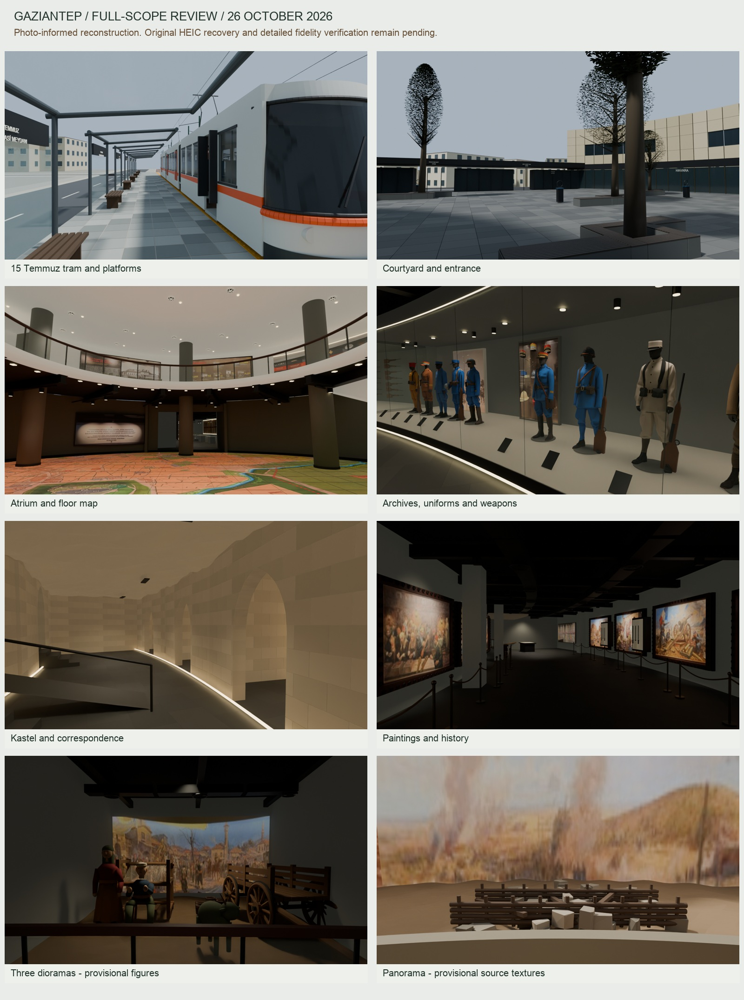
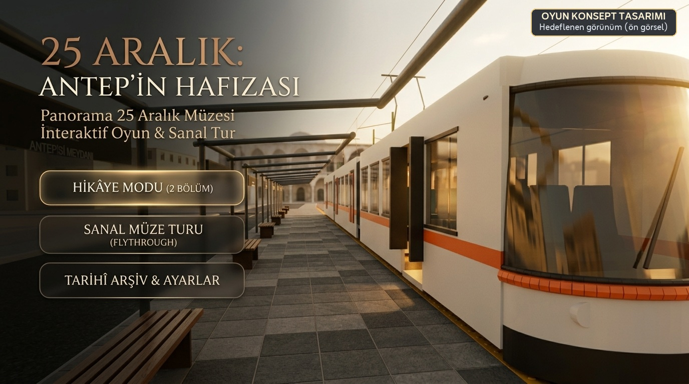
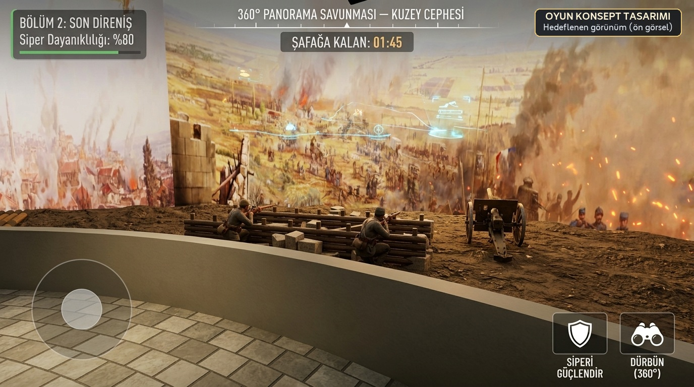

# Panorama 25 Aralık Museum — 3D Flythrough & Mobile Game

**3D Virtual Tour (Flythrough) and Two-Level Mobile Game for the Panorama 25 Aralık Museum (Gaziantep)**

This repository hosts the **9-part modular 3D Blender reconstruction** of the Panorama 25 Aralık Museum, our **game concept & level design documentation**, and the **Unity 3D (URP) mobile application** workspace where ongoing development updates are pushed.

---

## Project Status

| Phase | Milestone | Status | Summary |
| :--- | :--- | :--- | :--- |
| **Phase 1** | **3D Blender Museum Reconstruction** | Completed | Modeled the museum and exterior tram approach across 9 modular scenes (`part00`–`part08`, 3,227 meshes) plus a unified physics collision layer (`Colliders.fbx`, 1,559 collider surfaces) using 319 field reference photos. |
| **Phase 2** | **Game Concept & System Flow Design** | Completed | Designed *25 Aralık: Antep'in Hafızası*, combining **Mode A: Virtual Museum Flythrough** and **Mode B: Two-Level Story Game** with concept pre-visualizations: **[Game Concept Document (PDF)](docs/25_Aralik_Antepin_Hafizasi_Oyun_Konsepti_TR.pdf)** |
| **Phase 3** | **Unity 3D (URP) Mobile Implementation** | In Progress | Ongoing Unity mobile scene integration, Mixamo character animations, and gameplay implementation are tracked under [`unity/`](unity/). |

---

## Team Members

- **Ibrahim Hilvani** — [@IBRAHIMHILVANI](https://github.com/IBRAHIMHILVANI)
- **Nourullah Almohamad** — [@faa1n](https://github.com/faa1n)
- **Muhammed Alfath Bnshe** — [@MUHAMMEDALFATH](https://github.com/MUHAMMEDALFATH)

---

## Completed 3D Blender Museum Overview



---

## Game Concept Pre-Visualizations

Full game flow, level mechanics, and side-by-side 3D scene comparisons are available in **[docs/25_Aralik_Antepin_Hafizasi_Oyun_Konsepti_TR.pdf](docs/25_Aralik_Antepin_Hafizasi_Oyun_Konsepti_TR.pdf)**.





---

## 3D Assets (`.fbx` / `.blend`) & Walkthrough Video Downloads

To keep repository cloning fast, large binary `.fbx` models and the full museum walkthrough video are published under **[GitHub Releases (`v0.1.0`)](https://github.com/IBRAHIMHILVANI/panorama-25-aralik-museum/releases/tag/v0.1.0)**:

| Module | Museum Area | Release Asset |
| :--- | :--- | :--- |
| `part00` | 15 Temmuz Tram Station & Exterior Approach | `Gaziantep_00_Tram_Streets_Surroundings.fbx` |
| `part01` | Museum Forecourt & Main Entrance | `Gaziantep_01_Courtyard_Entrance.fbx` |
| `part02` | Circular Atrium & Giant Defense Floor Map | `Gaziantep_02_Atrium_Map_Hall.fbx` |
| `part03` | Archives, Regional Attire & Artillery Exhibits | `Gaziantep_03_Archives_Uniforms_Weapons.fbx` |
| `part04` | Stone Kastel Corridor & 1920 Correspondence Hall | `Gaziantep_04_Kastel_Correspondence.fbx` |
| `part05` | Historical Oil Paintings Gallery | `Gaziantep_05_Paintings_History.fbx` |
| `part06` | Three Dioramas Gallery (Workshop, Logistics, Hospital) | `Gaziantep_06_Three_Dioramas.fbx` |
| `part07` | 122m 360° Main Panorama Dome & 3D Trenches | `Gaziantep_07_Panorama.fbx` |
| `part08` | Projection / Cinema Hall (Sinevizyon) | `Gaziantep_08_Cinema_Reference_Study.fbx` |
| `Colliders` | Unified Physics Collision Meshes (1,559 Meshes) | `Gaziantep_Museum_Combined_Colliders.fbx` |
| `Combined` | Complete Combined Museum Scene Package | `Gaziantep_Museum_Combined.fbx` |
| `Video` | Full 3D Museum Walkthrough Recording | `Gaziantep_Full_Journey_Smooth_1p5x_2026-10-26.mp4` |

---

## Repository Structure

```text
panorama-25-aralik-museum/
├── docs/               # Game concept design (PDF/MD), project proposal, and concept renders
├── scripts/            # 3D Blender scene builders, texture processing, OCR, and validation scripts
├── reconstruction/     # Field photo catalogs, map OCR data, and per-part architectural notes
├── review/qa/          # QA scene renders across all 9 museum modules
├── output/             # Combined scene verification reports and fidelity overview renders
└── unity/              # Unity 3D (URP) mobile Flythrough & Game source workspace
```
