# 25 ARALIK: ANTEP'İN HAFIZASI

**Panorama 25 Aralık Müzesi İçin Sanal Tur (Flythrough) ve İki Bölümlü Mobil Oyun Konsept Tasarımı**

---

## 1. Genel Fikir ve Uygulama Yapısı

Panorama 25 Aralık Müzesi'nin üç boyutlu Blender modellemesini dokuz ayrı bölüm (*part00*–*part08*) halinde tamamladık. Projenin bir sonraki aşaması için bu hazır 3B sahneleri doğrudan kullanan, mobil cihazlarda (Android ve iOS) çalışacak iki modlu bir Unity 3D uygulaması tasarladık: birinci mod müzeyi gezmek isteyenler için *Sanal Müze Turu (Flythrough)*, ikinci mod ise oyunun tüm akışını gösterebilmek adına iki tam bölümden oluşan *Hikâye Oyunu* modudur.

Mobil kontrole uygun olması, müzenin her salonunu anlamlı şekilde kullanması ve Antep Savunması'nın tarihî ağırlığını koruması için oyun türünü *birinci şahıs araştırma, tarihî bulmaca ve 360° taktik savunma* olarak kurguladık. Bu dokümanda, Unity üzerinde kodlama aşamasına geçmeden önce düşündüğümüz oyun yapısını, bölümlerin işleyişini ve mevcut 3B modellerimiz üzerine hazırladığımız konsept ekran tasarımlarını sunuyoruz.

> **Görseller Hakkında Not:** Dokümandaki ham 3B sahneler Blender üzerinde tamamladığımız mevcut müze modellerimizdir. Üzerinde kullanıcı arayüzü (UI) bulunan görseller ise henüz kodlanmamış olup, ulaşmayı hedeflediğimiz oyun görünümünü anlatmak için hazırladığımız konsept tasarımlardır (ön görselleştirme).

**Tablo 1:** Proje hedefleri ve tasarladığımız karşılıkları.

| Hedeflenen Başlık | Tasarladığımız Çözüm | Planlanan Çıktı |
| :--- | :--- | :--- |
| Flythrough uygulaması ve sergi karakterlerinin animasyonu | Tramvay durağından 360° Panorama alanına uzanan otomatik kamera turu, serbest gezinme modu, sesli/yazılı bilgi kartları ve vitrinlerdeki karakterlerin canlandırılması. | Mod A: 3B Sanal Müze Turu |
| Mobil platform için oyun geliştirilmesi | Tek seviye yerine oyunun başlangıcını, bulmaca yapısını ve final savunmasını eksiksiz gösteren iki bağlantılı bölüm. | Mod B: İki Bölümlü Mobil Hikâye Oyunu |
| Unity 3D, Blender ve yeniden kullanılabilir altyapı | Dokuz parçalı modüler sahne yapısı ve *ScriptableObject* tabanlı temiz C# kodu ile sonraki dönemlerde kolayca genişletilebilen proje yapısı. | Modüler Unity Projesi ve Geliştirici Notları |

---

## 2. Tamamlanan 3B Blender Sahnelerimiz ve Oyundaki Rolleri

Müze içi ve yakın çevresi, çektiğimiz 319 saha fotoğrafı referans alınarak Blender'da toplam 3.227 *mesh* ve 1.559 fizik çarpışma yüzeyinden (*Colliders.fbx*) oluşan dokuz modül halinde hazırlanmıştır. Mevcut sahnelerimizin listesi ve hem sanal turda hem de oyunda nasıl kullanılacağı Tablo 2'de özetlenmiştir.

**Tablo 2:** Tamamladığımız 3B müze bölümleri ve uygulamadaki görevleri.

| 3B Modül | Müze Bölümü | Hazır 3B Modeller | Uygulamadaki Rolü |
| :--- | :--- | :--- | :--- |
| part00 – 01 | 15 Temmuz Tramvay Durağı ve Giriş Meydanı | PT8 tramvay modeli, durak kanopileri, çevre yapılar, müze giriş avlusu | Ana menü canlı arka planı ve Flythrough başlangıç noktası |
| part08 | Sinevizyon Salonu | Kademeli koltuklar, sinema perdesi, salon aydınlatma ve duvar yapısı | Oyun giriş sahnesi (Intro): 1920 cephe günlüğü başlangıcı |
| part02 | Atrium ve Zemin Haritası | Dairesel galeri, sütunlar, yüksek çözünürlüklü Antep savunma haritası | Bölüm 1: Harita üzerinde cephe noktalarını ve Kastel hattını bağlama |
| part03 | Arşiv, Kıyafetler ve Silahlar | 22 tarihî belge duvarı, 23 adet 3B kıyafet/karakter modeli, top vitrini | Bölüm 1: Canlanan Antep savunmacılarından şifre ipucu toplama |
| part04 | Kastel ve Yazışma Koridoru | Taş kemerler, rampa, 1920 daktilosu, mektup ve telgraf masası | Bölüm 1 Finali: Kastel su bendi geçişi ve şifreli telgraf çözümü |
| part05 – 06 | Tablolar ve Üç Diorama Salonu | 10 yağlıboya tablo; fişek atölyesi, kağnı ve sahra hastanesi dioramaları | Bölüm 2 Başlangıcı: Canlanan dioramalarda cephe ikmal hazırlığı |
| part07 | 360° Ana Panorama Kubbesi | 122 m çevreli panoramik tuval, izleme platformu, 3B ahşap siperler | Bölüm 2 Finali: 360° dürbünle cephe gözetleme ve siper savunması |

---

## 3. Oyun Akışı, Modlar ve Karakter Animasyonu

### 3.1. Genel Akış

Uygulama açıldığında tramvay durağı sahnesi üzerinde ana menü yer alır. Kullanıcı buradan doğrudan Sanal Müze Turu'na girebilir ya da iki bölümlük Hikâye Modu'nu başlatabilir:

1. **Ana Menü (`part00–01`):** Canlı 3B sahne üzerinde Flythrough veya Hikâye Oyunu seçimi.
2. **Giriş / Intro (`part08`):** Sinevizyon salonunda eksik 1920 cephe günlüğü ile görevin başlaması.
3. **Bölüm 1 (`part03 -> part02 -> part04`):** Arşiv ipuçları, zemin haritası rotası ve Kastel telgraf şifresi.
4. **Bölüm 2 (`part05 -> part06 -> part07`):** Diorama ikmal hazırlığı ve 360° Panorama savunması.
5. **Kapanış:** 25 Aralık kurtuluş sabahı ve kahraman arşiv kartları.

### 3.2. Mod A: Sanal Müze Turu (Flythrough)

Sanal Müze Turu modunda iki gezinme seçeneği bulunur: Unity *Cinemachine* ile hazırlanan otomatik sinematik kamera rotası ve dokunmatik kontrollerle gezilebilen serbest yürüyüş modu. Ziyaretçi galerilerde ilerlerken önemli eserlerin önünde Türkçe yazılı ve sesli bilgi kartlarını açabilir.

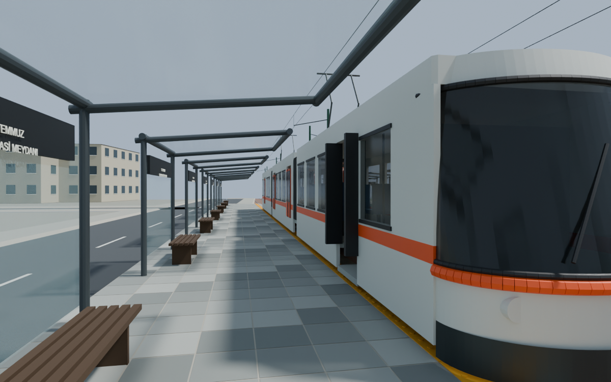
**Şekil 2:** Mevcut 3B Blender modelimiz — 15 Temmuz Tramvay Durağı, PT8 tramvayı ve müze dış giriş alanı (*part00* sahnesi).

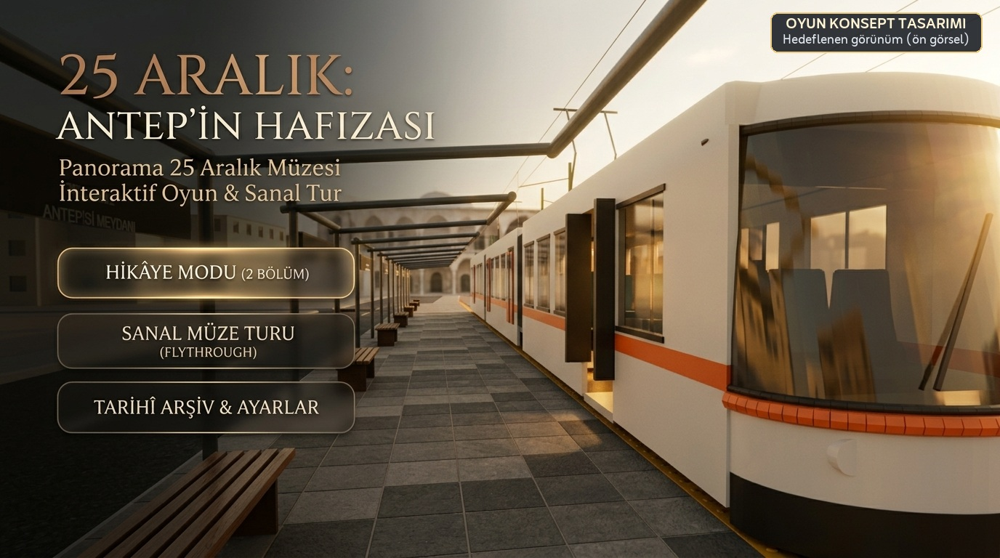
**Şekil 3:** Ana menü konsept tasarımımız (ön görsel) — mevcut *part00* modelimiz üzerinde gün batımı ışıklandırması, Hikâye Modu ve Sanal Müze Turu seçim ekranı.

### 3.3. Mod B: Hikâye Kurgu, Canlanan Karakterler ve Mobil Kontroller

Hikâye modunda oyuncu, Antep Savunması gazisi büyükbabasından kalan ve son sayfaları eksik olan 1920 tarihli bir cephe günlüğü ile müzeye gelen genç bir araştırmacıyı yönetir. Oyuncu önemli vitrinlere yaklaştığında ortam ışığı yumuşakça değişir; müzede sergilenen yöresel Antep savunmacıları ve diorama karakterleri Mixamo tabanlı iskelet animasyonlarıyla (konuşma, işaret etme, cephe hazırlığı) canlanarak oyuncuya o günkü görev ve şifre ipuçlarını aktarır.

Mobil ekranı kalabalıklaştırmamak için sol altta sanal *Joystick*, sağ tarafta dokunmatik kamera bakışı ve yalnızca etkileşimli bir nesneye yaklaşıldığında beliren tek bir aksiyon butonu (*Belgeyi İncele, Rotayı Bağla, Siperi Güçlendir*) kullanılacaktır.

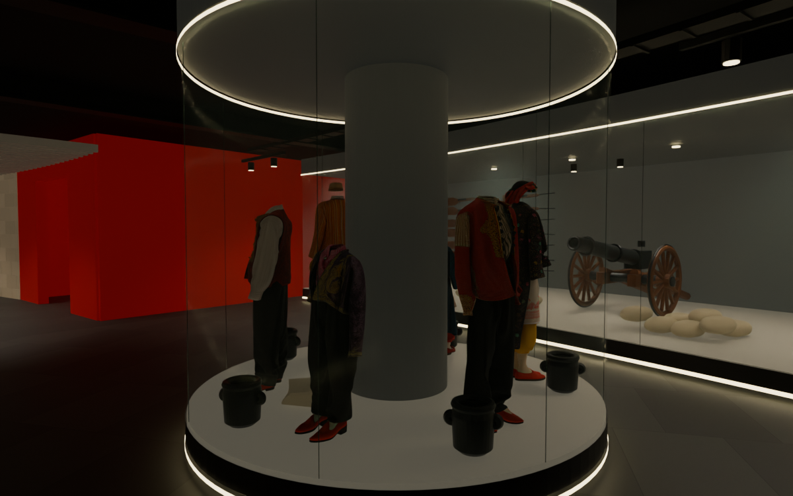
**Şekil 4:** Mevcut 3B Blender modelimiz — yöresel Antep savunmacı kıyafetleri (cepken, şalvar, yemeni) ve ahşap tekerlekli top vitrini (*part03* sahnesi).

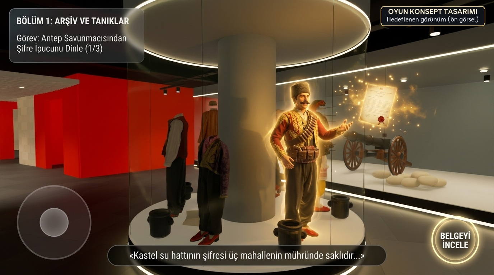
**Şekil 5:** Karakter animasyonu konseptimiz (ön görsel) — *part03* vitrinindeki Antep savunmacısının canlanarak oyuncuya Kastel su hattı şifresi için ipucu vermesi.

---

## 4. Bölüm Tasarımları (İki Tam Bölüm)

### 4.1. Bölüm 1: Arşiv, Harita ve Kastel Hattı (`part08 -> part03 -> part02 -> part04`)

Birinci bölüm keşif ve bulmaca odaklıdır. Kuşatma sırasında mahalleler arası yüzey bağlantısı kesildiğinde, Antep halkı şehrin altındaki taş su kanallarını (*Kasteller*) gizli haberleşme ve erzak yolu olarak kullanmıştır. Oyuncunun amacı, arşivdeki ipuçlarını toplayıp harita üzerinde güvenli Kastel rotasını açmak ve şifreli telgrafı karargâha göndermektir:

1. **Arşivde İpucu Toplama (`part08` ve `part03`):** Sinevizyon salonundaki kısa girişten sonra oyuncu Arşiv salonuna geçer. Belgeleri inceler ve canlanan üç Antep savunmacısından üç mahalle mührüne ait şifre ipuçlarını Not Defteri'ne kaydeder.
2. **Zemin Haritası Rota Bulmacası (`part02`):** Oyuncu Atrium'daki büyük Gaziantep zemin haritasına iner. Topladığı ipuçlarına göre harita üzerindeki cephe noktalarını doğru sırayla birbirine bağlar; doğru hat kurulduğunda Kastel geçidinin kapısı açılır.
3. **Kastel Su Hattı ve Şifreli Telgraf (`part04`):** Oyuncu taş kemerli Kastel koridorunda su kapaklarını yönlendirerek yazışma masasına ulaşır. Masadaki 1920 model telgraf/daktilo ekranında şifreyi çözüp mesajı Merkez Karargâh'a ileterek Bölüm 2'ye geçer.

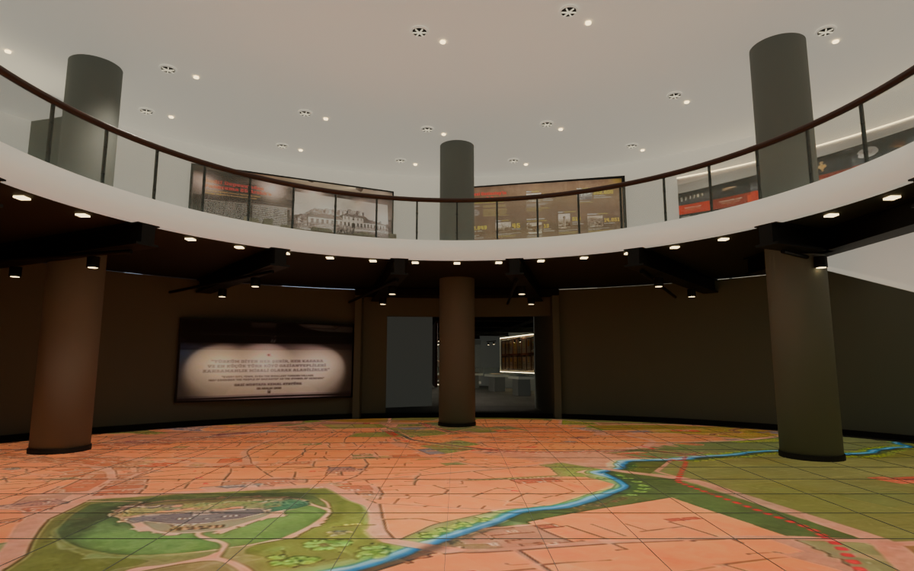
**Şekil 6:** Mevcut 3B Blender modelimiz — dairesel Atrium galerisi ve Gaziantep savunma haritası zemini (*part02* sahnesi).

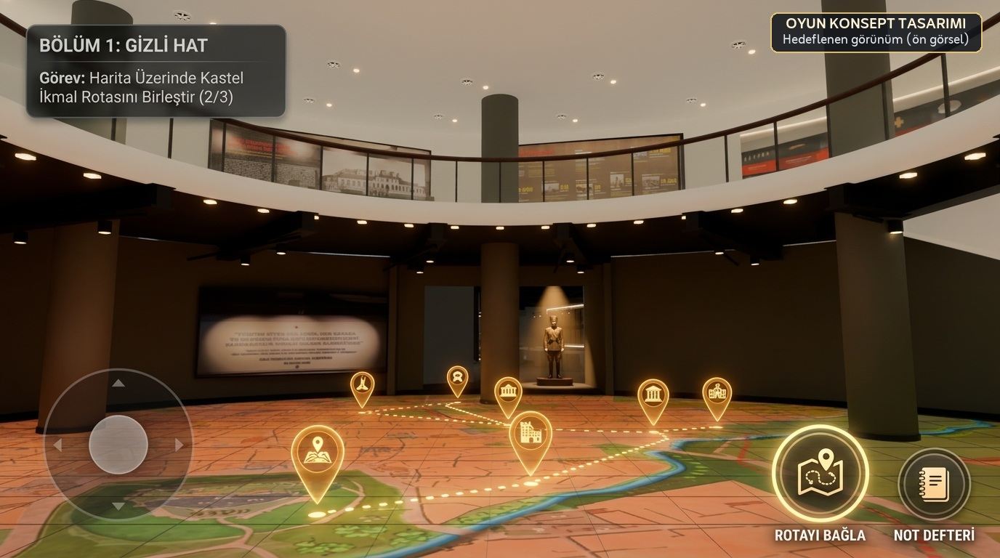
**Şekil 7:** Bölüm 1 harita bulmacası konseptimiz (ön görsel) — zemin haritası üzerinde cephe noktalarını birleştirerek güvenli Kastel ikmal hattını oluşturma ekranı.

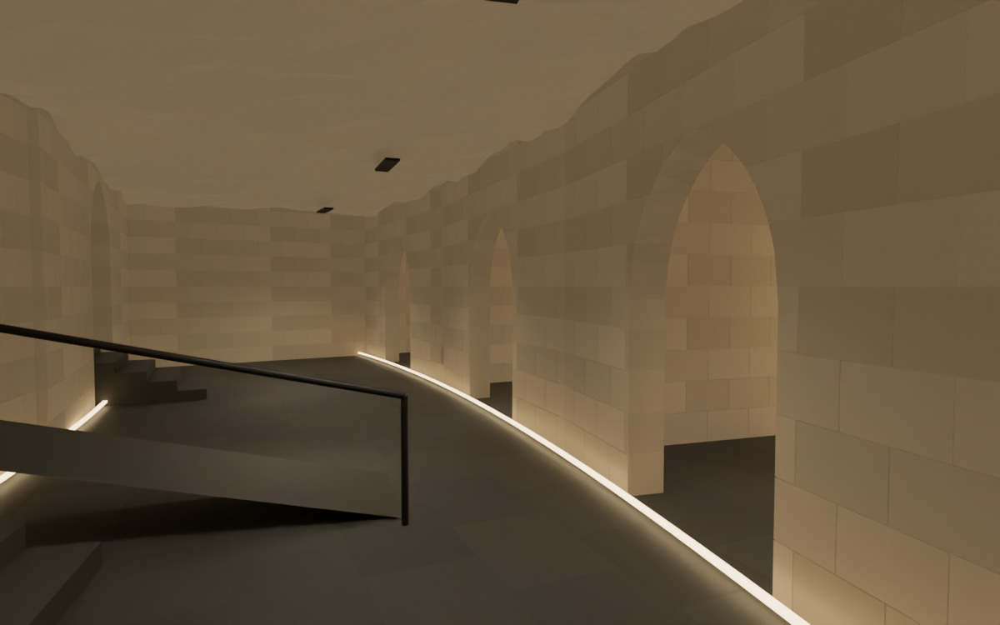
**Şekil 8:** Mevcut 3B Blender modelimiz — taş kemerli Kastel koridoru, rampa ve zemin aydınlatma şeritleri (*part04* sahnesi).

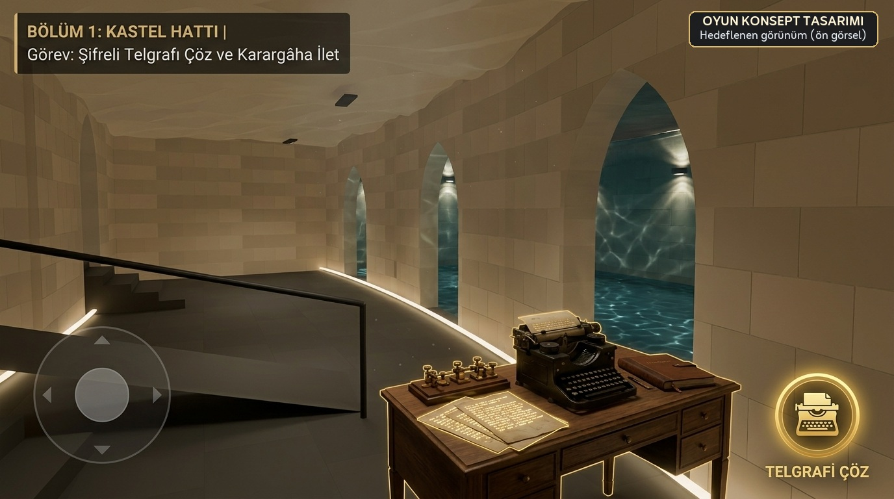
**Şekil 9:** Bölüm 1 finali konseptimiz (ön görsel) — Kastel su hattı atmosferi ve 1920 telgraf/daktilo masasında şifre çözme etkileşimi.

### 4.2. Bölüm 2: Diorama İkmali ve 360° Panorama Savunması (`part05 -> part06 -> part07`)

İkinci bölüm daha hareketli bir tempoya sahiptir; cephe gerisi hazırlığını ve 360° Panorama salonundaki son savunmayı konu alır:

1. **Canlanan Dioramalarda İkmal Hazırlığı (`part05` ve `part06`):** Tablolar galerisinden geçen oyuncu, üç diorama sahnesine (*fişek atölyesi, kağnı lojistiği ve sahra hastanesi*) ulaşır. Canlanan dioramalarda dokunmatik mini görevlerle mühimmat sandıklarını ve ilk yardım malzemelerini hazırlayarak savunma aşaması için *İkmal Puanı* toplar.
2. **360° Panorama Kubbesinde Taktik Savunma (`part07`):** Oyuncu tünelden çıkarak 122 metre çevreli dairesel Panorama platformuna gelir. Burada *360° Dürbün* (dokunmatik kaydırma veya telefon jiroskopu) ile dört cepheyi (Kuzey, Güney, Doğu, Batı) kontrol eder. Üç dalga boyunca hasar alan ahşap siperleri güçlendirir, mühimmat gönderir ve top atış açısını ayarlayarak savunma hattını şafağa kadar korur.
3. **25 Aralık Kurtuluş Sabahı:** Son dalga tamamlandığında dumanlar dağılır, kubbe sabah ışığıyla aydınlanır; büyükbabanın günlüğünün eksik sayfası tamamlanır ve *Şahin Bey, Şehit Kâmil, Karayılan* gibi kahramanların tarihî arşiv kartları açılır.

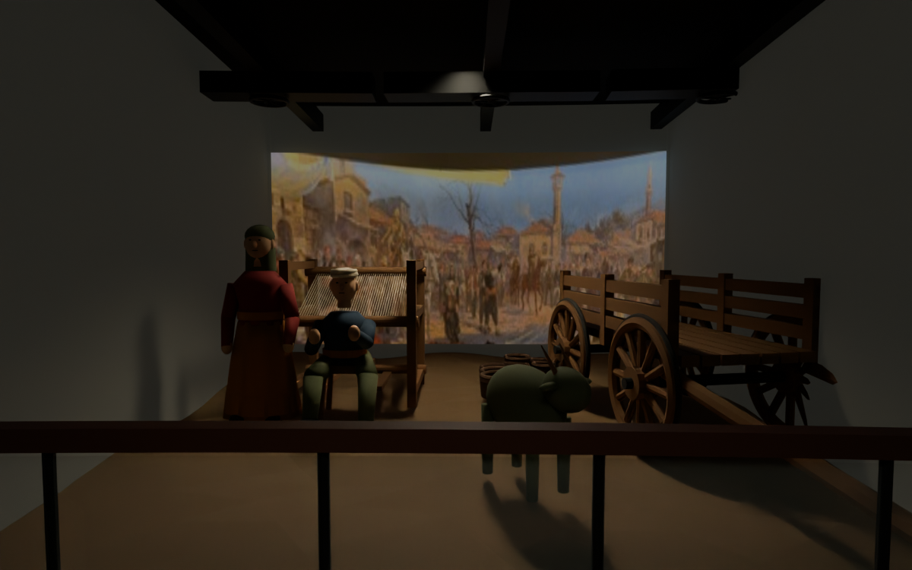
**Şekil 10:** Mevcut 3B Blender modelimiz — mühimmat üretimi ve cephe lojistiğini gösteren Diorama galerisi (*part06* sahnesi).

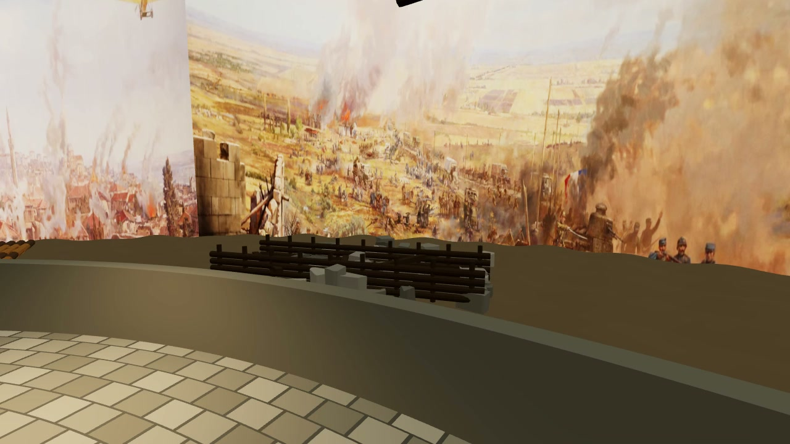
**Şekil 11:** Mevcut 3B Blender modelimiz — 122 metre çevreli 360° ana panorama tuvali, izleme platformu ve 3B ahşap siperler (*part07* sahnesi).

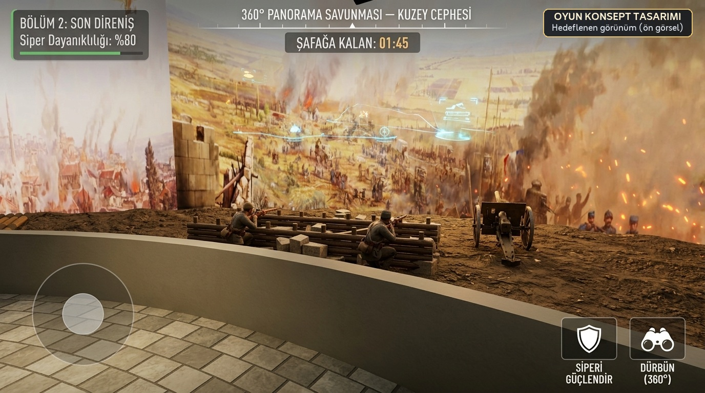
**Şekil 12:** Bölüm 2 finali konseptimiz (ön görsel) — 360° Panorama alanında siper savunması, top bataryası, cephe dayanıklılık çubuğu ve dürbün kontrolleri.

---

## 5. Unity 3D Teknik Yapı ve Geliştirme Adımları

Birleşik Blender dosyamız yaklaşık 1,86 milyon poligon ve 94 doku içerdiği için, sahneyi tek parça halinde mobil belleğe yüklemek yerine dokuz parçalı yapımızı doğrudan değerlendireceğiz:

- **Parçalı Sahne Yükleme (Additive Scene Loading):** Bellekte yalnızca oyuncunun bulunduğu salon ve bir sonraki geçiş salonu açık tutulacak, geride kalan salonlar bellekten boşaltılarak mobil cihazlarda RAM kullanımı düşürülecektir.
- **Mobil Grafik Optimizasyonu (URP Mobile):** Gerçek zamanlı ağır gölgeler yerine önceden pişirilmiş statik ışıklandırma (*Baked Lightmaps*), *Occlusion Culling*, mobil uyumlu *ASTC* doku sıkıştırması ve yüksek poligonlu 3B kıyafetlerde poligon azaltma (*LOD*) kullanılacaktır.
- **Modüler Kod Yapısı (ScriptableObject):** Görev adımları, eser bilgileri ve şifre bulmacaları *ScriptableObject* veri dosyaları olarak ayrıştırılacaktır; böylece ileride aynı proje üzerine yeni bölümler veya VR desteği kolayca eklenebilecektir.

**Tablo 3:** Planladığımız Unity geliştirme ve entegrasyon adımları.

| Aşama | Çalışma Başlığı | Yapılacak Teknik İşlemler |
| :--- | :--- | :--- |
| 1. Adım | Sahne Aktarımı ve Optimizasyon | part00–08 ve Colliders.fbx dosyalarının Unity URP projesine aktarılması, ASTC doku sıkıştırma, LOD ve statik ışık (Lightmap) ayarları. |
| 2. Adım | Mobil Kontroller ve Flythrough | Mobil birinci şahıs kontrolcüsünün, Cinemachine otomatik kamera turunun ve sesli/yazılı eser bilgi kartlarının hazırlanması (Mod A). |
| 3. Adım | Karakter Animasyonları ve Bölüm 1 | Vitrin karakterlerine Mixamo animasyonlarının eklenmesi; Arşiv ipucu sistemi, zemin haritası rota bulmacası ve Kastel telgraf şifresinin kodlanması. |
| 4. Adım | Bölüm 2: Diorama ve 360° Savunma | Diorama ikmal mini görevlerinin, 360° dürbün sisteminin, üç dalgalı siper dayanıklılık ve top yönlendirme mekaniğinin kodlanması. |
| 5. Adım | Arayüz, Ses ve Mobil Cihaz Testleri | Türkçe menü ve oyun içi arayüzlerin tamamlanması, ses efektlerinin eklenmesi ve farklı Android/iOS ekranlarında performans testleri. |

Onayınız ve yönlendirmeleriniz doğrultusunda, yukarıda özetlediğimiz akış ve teknik yapı üzerinden Unity 3D geliştirme aşamasına başlamayı planlıyoruz.
